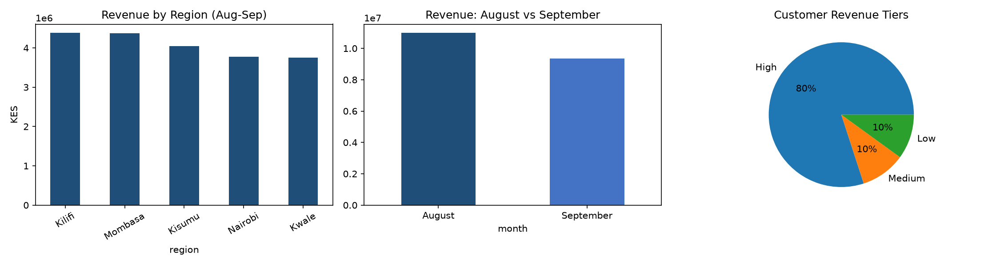
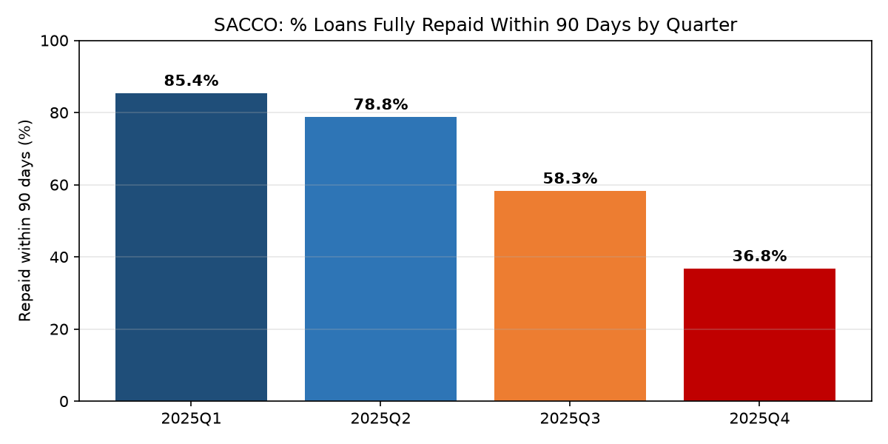

# AI Masterclass - Data Analyst - API Phase

Week 1: Learning APIs, authentication, and fetching live data.

## Projects

- **Day 1 - API Basics**: `day1-api-basics/day1_api.py` - First API call
- **Day 2 - Exchange Rate**: `day2-exchange-rate/day2_rate.py` - Currency conversion
- **Day 3 - Travel Info**: `day3-travel-info/day3_travel_info.py` - Chained APIs (weather + country)
- **Day 4 - Live data (Browser)**: `day4-live-data/day4_fetch_exercise.html` fetch() with loading & error states - Live Bitcoin price from CoinGecko
- **Day 5 - Portfolio Project**: `kenyan-currency-tracker/tracker.py` - Kenyan Business Currency Tracker for SMEs

# Weather Now - Live CLI Weather Tool 
**Problem it solves:** You need fast, accurate weather for any city for travel, farming, or planning your day without as or complex websites.

** How it works:**
- Takes city name from user
- call 1: Geocoding API to get coordinates
- Call 2: Weather API to get live temperature, wind, humidity
- Saves Json and prints clean output

**How to run:**
'''bash
pip install requests
python weather_noy.py
# Enter: Nairobi

# Day 4 - Fetch API $ Live Data

Live Demo:`https://YOUR_USERNAME.github.io/YOUR_REPO/day4_fetch.html`
> Replace Your_USERNAME / YOUR_REPO with yours after enabling GitHub Pages.

### What it does
Fetches live Bitcoin price from CoinGecko API and displays it in USD & KES.

I started with REST Countries API (Country Info) but the API was unstable / blocked on my network and kept returning `Failed to fetch`. I switched to a more reliable public API that still meets Day 4 requirements.

### Features (meets all assignment criteria)
- [x] Uses `fetch()` with `async / await`
- [x] Shows **Loading...** state while fetching
- [x] shows **formatted output** - not raw JSON
- [x] shows **clear error handling** for invalid input
- [x] Clean, responsive UI

### How to test
1. Open `day_fetch.html`
2. Click `Refresh Price` -> Success: Shows BITCOIN, USD, KES
3. Type `bad-coin` in input -> Click Refresh -> Error: red box `Coin "bad-coin" not found...`

### Tech
- HTML, CSS, Vanilla JavaScrip
- API: https://api.coingecko.com/api/v3/simple/price

### API Example
`https://api/coingecko.com/api/v3/simple/price?ids=bitcoin&vs_currencies=usd,kes`

### What I learned
- Difference between `" "` and backticks `` ` `` for template literals `${ }`
- Handling CORS / network failures with try/catch
- Using `response.ok` to detect 404s
- Live Server on VS Code (port 5500)

### Files
- `day4_fetch.html` - Main Day 4 project

## Day 5 - How to run

## Day 8 Automated WhatsApp Reply System

# Automated WhatsApp Reply System

An automated WhatsApp bot that replies instantly to customers asking about prices, stock, and delivery times.

## Features
- Auto-replies to questions about prices, stock, and delivery times
- Admin page to update product list and prices without touching code
- Flags messages outside FAQ scope to team with a daily digest

## How to Run
1. Clone the repo: `git clone [your-repo-link]`
2. Install requirements: `pip install -r requirements.txt`
3. Create a `.env` file with your WhatsApp API token
4. Run: `python main.py`
5. Test with the test number provided

## What I Assumed
- Client has a WhatsApp Business account
- Product list is updated via admin page, not directly in code
- Messages outside FAQ are not auto-answered, they are flagged for human follow-up

## Day 10 Dairy Co-op Price Checker
# Dairy Co-op Price Checker

Simple tool for Kiambu Dairy Co-op. Farmer enters name + litres, sees total owed.

## How to Run
1. `pip install` - no extra packages needed
2. Edit `price.txt` to set weekly price (e.g. 55.0)
3. Run: `python dairy_calculator.py`

## Example Output
Farmer : Wanjiru
Litres : 20
Price  : KES 55.00/litre
Total  : KES 1,100.00

## Assumption
Price is stored in price.txt. Manager updates it weekly.

## Supermarket Foot Traffic - Seasonal Analysis
Foot traffic shows a clear seasonal pattern with a December peak and a February dip, but the 30-day rolling average confirms genuine underlying growth, rising from ~850 to ~1,000 daily transactions over 18 months. We recommend increasing staff and stock in November-December and running promotions in February to smooth the low season.

## Day 13: Statistical Analysis
Mean can lie when there is an outlier. In the sales data, mean was KES 115,750 but median was KES 28,500 because of one KES 890,000 sale. T-test confirmed Nairobi sales are significantly higher than Kisumu (p = 0.003), so we recommend adding a distributor in Kisumu.

## Mombasa Microfinance - Loan Repayment Analysis
Typical loan is KES 50,000 (median), but the average is higher because of a few unusually large loans over KES 380,000. 
Correlation sentence for the board: "In plain terms, bigger loans tend to take a little longer before the first repayment comes in, but the link is not strong enough to change our lending rules — we should watch the very large loans more closely, not punish all large loans."

## Day 14: Kisumu County
Finding: In Kisumu County, schools with more classrooms have significantly higher attendance (r = 0.91), with schools having 12+ classrooms averaging over 92% attendance compared to under 75% for schools with 6 or fewer classrooms — suggesting classroom capacity is a key driver of attendance.

## Day 15: Complex Analysis - Distributor Aug-Sep

**Findings:**
Revenue fell 15.0% from August to September, from KES 10,994,000 to KES 9,339,800.
Kilifi and Mombasa are the strongest regions, together contributing ~43% of total revenue (KES 20,333,800), while Nairobi ranks only 4th despite being the capital.
Hassan Traders grew 117.5% in September (KES 829,200 to KES 1,803,200) and is now the top customer, so the overall decline came entirely from dormant and shrinking accounts, not top accounts.
2 customers who ordered in August did not reorder in September — Baraka Wholesalers (KES 1,405,800) and Chebet Store (KES 678,200) — representing KES 2,084,000 in dormant revenue worth pursuing before end of quarter.

## Day 15: SACCO Loan Portfolio — Quarterly Repayment Analysis

### Question
What percentage of loans issued in each quarter are fully repaid within 90 days?

### Quarterly Repayment Rate Table
| Quarter | Total Loans | Total Amount (KES) | Repaid in 90 Days | Repayment Rate | Not Repaid |
|---------|-------------|-------------------|-------------------|----------------|------------|
| 2025Q1 | 41 | 4,775,000 | 35 | 85.4% | 6 |
| 2025Q2 | 33 | 3,915,000 | 26 | 78.8% | 7 |
| 2025Q3 | 48 | 5,540,000 | 28 | 58.3% | 20 |
| 2025Q4 | 38 | 3,950,000 | 14 | 36.8% | 24 |
| **Total** | **160** | **18,180,000** | **103** | **64.4%** | **57** |

### Repayment by Loan Size
- Small (<=50k): 71.9%
- Medium (51k-100k): 54.1% — worst
- Large (>100k): 62.7%

### Recommendation
Repayment within 90 days fell 48.6 points from 85.4% in Q1 to 36.8% in Q4. In Q4, almost 2 in 3 borrowers missed the 90-day target. We recommend the SACCO immediately pause automatic approval for Medium loans (KES 51k-100k) — the worst-performing band at 54.1% — and add a mandatory 30-day check-in call for all new loans until the quarterly rate recovers above 70%.

### Pricing for a distributor:Setup Fee: KES 15,000 - 25,000 one-time
This covers building the database, cleaning their Excel data, writing the 5 Monday reports, and training their staff to run it. Takes 2-3 days.Monthly Support: KES 5,000 - 8,000 / month
This covers adding new reports when the manager asks new questions, fixing errors, adding new products/counties, and a monthly check that the data is correct. The manager saves 3 hours per month (45 mins x 4 Mondays) and gets zero Excel mistakes.Why separate? Setup is building the house. Monthly is maintaining it. If they stop paying monthly, the reports still work, they just don't get new changes.

### Day 17: Nairobi Distributor - Customer Revenue Analysis

## What each query answers and why a sales manager cares

**1. Orders with Account Tier (JOIN)**
Answers: Which tier is driving each order?
Manager cares: Gold customers should get priority delivery and better service. If Gold orders drop, revenue drops.

**2. Total Spend - Customers with >3 Orders (GROUP BY + HAVING)**
Answers: Who are our true repeat buyers?
Manager cares: Repeat buyers are cheaper to keep than finding new ones. If this list is empty, we have a loyalty problem - we are not getting customers to come back.

**3. Top Customer Per County (Window Function)**
Answers: Who is the #1 customer in each county?
Manager cares: Don't put all your sales team in one county. You need a champion in Mombasa, Kisumu, Nairobi, etc. If one county dominates, you are at risk if that customer leaves.

## Pricing Note
This level of SQL reporting work (JOIN + GROUP BY + Window Function) is typically priced at KES 5,000 - KES 15,000 per report for a small distributor.